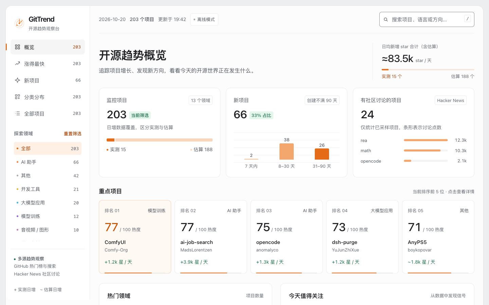

<div align="center">

# 🔭 GitTrend

**每天扫描 GitHub,算出「谁在加速」——帮你发现前沿项目,而不是围观总星榜。**

[](https://opensource.org/licenses/MIT)
[](https://www.python.org/)
[](#-零后端零数据库)

一个 `.py` 文件 + 一个 `.html` 文件,双击就能看的本地趋势看板。

</div>

---

## ✨ 它解决什么问题

GitHub Trending 只会告诉你「今天谁最火」,而总星榜永远被 Django、React 这些巨无霸霸占。真正值得早发现的是另一批东西:

> **几十天内冒出来的新项目 · 增速突然抬头的项目 · 以及——它到底是不是虚火。**

GitTrend 每天抓一遍数据,把这三件事合成一个可以反复打开、可以筛选、可以点进去看细节的看板。

现成的工具都只做了一半:TrendRadar 是「资讯推送」不是「趋势发现」,star-history 只服务「你已经知道要看的仓库」。**发现「谁在加速」这件事,没人合在一起做**,所以自己写了一个。

## 🚀 特性

- 📡 **三层信号,互相校验**
  - **GitHub Trending** —— 日/周/月榜 + 6 个语言榜 + 中文圈,拿官方口径的日增
  - **GitHub Search API** —— 抓还没进榜的新项目(30 天 >400★、90 天 >1500★)
  - **Hacker News** —— 用真实讨论热度分辨「真火」还是「刷的」
- 🎯 **动量分,不看总星看加速度** —— 速度 / 加速度 / HN 热度 / 新鲜度,加权求和
- 📝 **中文项目说明** —— 重点卡片、项目列表、分类和详情共用简短中文用途介绍，支持按中文用途搜索。
- ⭐ **突出总增长** —— 深橙色总览区搭配白色文字和立体星星呈现日均新增；总览区仅保留总增长数值，实测与估算明细在下方监控项目卡片展示。星星素材构建时内联，离线也可显示。
- 📈 **按速度发现、按新鲜度探索** —— 涨得最快突出日均新增大数字与历史走势；新项目按创建时间从新到旧排列，优先展示创建天数、日期与中文用途。
- 🧭 **五个视图** —— 概览、涨得最快、新项目、分类分布、全部项目
- 🔍 **能筛选、能搜索** —— 按领域 / 语言 / 最小动量过滤,`/` 聚焦搜索,点项目在右侧内容区进入独立详情页，左侧导航保持可用；标题旁可直接打开 GitHub 和 Star 增长曲线；返回保留筛选和浏览位置
- 💾 **零后端、零数据库、零构建** —— 数据直接内联进 HTML,双击即开;配合常驻本地服务还能自动刷新
- 🧾 **数据口径诚实** —— 实测日增标 `+`,推算值标 `~`,拿不到的数据宁可空着,绝不编一个
- 📅 **每天自动跑** —— cron / launchd / 本地服务器三种方式,历史快照越攒越准

## 🎬 预览

<p align="center">
  
</p>

## 🔧 快速开始

只依赖 `requests` 和 `beautifulsoup4`:

```bash
git clone https://github.com/BMBWaveforms/GitTrend.git
cd GitTrend
pip install requests beautifulsoup4
python3 radar.py            # 约 60–90 秒,跑完自动生成 dashboard.html
```

双击生成的 `dashboard.html`,就是完整看板。

常用参数:

```bash
python3 radar.py --no-hn         # 跳过 HN 查询(快 30 秒)
python3 radar.py --token ghp_xxx # 带 GitHub token,限额 60→5000/小时(可选,不带也能跑)
python3 radar.py --loop 360      # 每 6 小时自动采一轮
```

## 🧠 它怎么判断「趋势」

**动量分** = `52% × 速度 + 23% × 加速度 + 17% × HN 热度 + 8% × 新鲜度`

| 维度 | 含义 | 为什么这么设计 |
|---|---|---|
| 🚀 速度 | 日均新增 star | 对数归一化,否则一个日增几万的项目会把所有人压成 0 分 |
| 📈 加速度 | 当日速率 ÷ 7 日均速 | `>1` 热度还在往上走,`<1` 在退潮 |
| 💬 HN 热度 | 讨论点数 + 2×评论数 | 有人真在讨论,才是真火 |
| 🌱 新鲜度 | 180 天内的新项目加分 | 越新加得越多,新概念往往藏在新生项目里 |

## 🔎 关于数据,几句实话

不是每个仓库都能拿到「今日新增」。表格里数字前的符号代表可信度:

| 符号 | 含义 |
|---|---|
| `+` | **真实日增**(日榜标注 / 本地快照差),最可信 |
| `~` | **推算值**(周榜÷7、月榜÷30),只能看量级 |

GitHub 每天只放出 12 条日榜,所以大多数仓库是估算——**这是数据源的限制,不是 bug**。跑得越久,本地快照攒得越多,数字就越脱离榜单推算、越接近真实。

## 🕐 每天自动跑

**第一步 · 定时采集(二选一)**

cron 一行(把 `/path/to/GitTrend` 换成实际路径):

```bash
crontab -e
# 每天早上 9:17 跑一次
17 9 * * * cd /path/to/GitTrend && /opt/homebrew/bin/python3 radar.py >> data/run.log 2>&1
```

macOS 更推荐 launchd(电脑关机错过会补跑),完整 plist 见下方折叠。

**第二步 · 让看板自动刷新**

看板靠本地服务器拉最新数据。把它常驻后台后,**双击 `dashboard.html` 打开就会自动连上、每 60 秒刷新**,不用手动开终端:

```bash
python3 serve.py              # 前台临时跑(自动开浏览器)
python3 serve.py --no-browser # 后台常驻模式(不弹浏览器,配合 launchd)
```

<details>
<summary>macOS launchd 完整配置:采集 + 常驻服务(点开)</summary>

把 `/path/to/GitTrend` 换成实际路径。

**① 采集**(每天 9:17,存为 `~/Library/LaunchAgents/com.yourname.ghradar.plist`):

```xml
<?xml version="1.0" encoding="UTF-8"?>
<!DOCTYPE plist PUBLIC "-//Apple//DTD PLIST 1.0//EN" "http://www.apple.com/DTDs/PropertyList-1.0.dtd">
<plist version="1.0"><dict>
  <key>Label</key><string>com.yourname.ghradar</string>
  <key>ProgramArguments</key>
  <array>
    <string>/opt/homebrew/bin/python3</string>
    <string>/path/to/GitTrend/radar.py</string>
  </array>
  <key>WorkingDirectory</key>
  <string>/path/to/GitTrend</string>
  <key>StartCalendarInterval</key><dict><key>Hour</key><integer>9</integer><key>Minute</key><integer>17</integer></dict>
  <key>StandardOutPath</key><string>/path/to/GitTrend/data/run.log</string>
  <key>StandardErrorPath</key><string>/path/to/GitTrend/data/run.log</string>
</dict></plist>
```

**② 常驻服务**(存为 `~/Library/LaunchAgents/com.yourname.ghradar-serve.plist`,比上面多 `RunAtLoad` + `KeepAlive`,命令换成 `serve.py --no-browser`):

```xml
<?xml version="1.0" encoding="UTF-8"?>
<!DOCTYPE plist PUBLIC "-//Apple//DTD PLIST 1.0//EN" "http://www.apple.com/DTDs/PropertyList-1.0.dtd">
<plist version="1.0"><dict>
  <key>Label</key><string>com.yourname.ghradar-serve</string>
  <key>ProgramArguments</key>
  <array>
    <string>/opt/homebrew/bin/python3</string>
    <string>/path/to/GitTrend/serve.py</string>
    <string>--no-browser</string>
  </array>
  <key>WorkingDirectory</key>
  <string>/path/to/GitTrend</string>
  <key>RunAtLoad</key><true/>
  <key>KeepAlive</key><true/>
  <key>StandardOutPath</key><string>/path/to/GitTrend/data/serve.log</string>
  <key>StandardErrorPath</key><string>/path/to/GitTrend/data/serve.log</string>
</dict></plist>
```

加载两个:

```bash
launchctl load -w ~/Library/LaunchAgents/com.yourname.ghradar.plist
launchctl load -w ~/Library/LaunchAgents/com.yourname.ghradar-serve.plist
```

</details>

## 🤝 想改它 / 一起开发

这个项目刻意保持「一个 py + 一个 html」的最小形态,每个默认值都是踩坑换来的。

- 想加监控语言 / 领域、调打分权重、加视图:改哪里都写清楚了,见 [AGENTS.md](AGENTS.md)
- 改完任何东西跑一遍自检:

```bash
python3 check.py   # 通过输出 OK,否则逐条指出哪个仓库哪个字段有问题
```

## 📂 文件结构

```
GitTrend/
├── radar.py              # 采集 + 打分,主程序
├── template.html         # 看板模板(改 UI 改这里)
├── dashboard.html        # 成品看板(生成物,双击即开)
├── serve.py              # 本地服务器,让看板自动刷新(可 --no-browser 常驻)
├── build_dashboard.py    # 用已有数据重建看板
├── check.py              # 自检脚本
├── AGENTS.md             # 给协作 AI Agent 的说明
└── data/                 # 长期价值所在:历史快照、创建时间缓存
```

## 📜 License

[MIT](LICENSE) © 2026 BMBWaveforms

## 中文说明的维护

`data/project_summaries_zh.json` 保存按仓库名索引的中文说明、对应原始简介、来源链接和核对日期。当前这批说明覆盖 2026-11-16 本地数据中的 184 个项目，依据仓库简介整理；缺少或过于简略的简介补查项目 README。说明为离线整理内容，不是实时自动翻译。

构建时说明目录会内联进看板，`data/latest.json` 和历史数据不被修改。实时刷新后仅使用仓库名和原始简介都匹配的中文说明，避免将过期说明套到已变化的项目上。新增项目或简介变化时暂时显示仓库原文，避免无用途信息的占位文案；`check.py` 会列出需要维护的项目。模板预览与生成看板首次打开及自动刷新时同步加载说明目录，说明单独更新也会生效；网络不可用时保留内嵌中文说明。补充说明后执行 `python3 build_dashboard.py`，更新离线版本。

## 项目图片

涨得最快和新项目展示 GitHub 维护者头像（不将个人头像冒充项目 Logo）。`assets/project-avatars.json` 记录来源，图片保存在 `assets/project-avatars/`；构建时内联到 HTML，离线打开不会请求 GitHub。缺少图片或加载失败时显示名称首字母。

新增项目后可运行 `python3 scripts/cache_project_avatars.py` 缓存尚未保存的头像，再运行 `python3 build_dashboard.py`。模板预览从本地素材目录加载，生成看板使用内嵌图片。

## 项目详情中的历史与讨论

详情按“核心指标 → 为什么上榜 → Star 历史 → 国外社区讨论”排列。历史图展示最近 30 次采集记录；鼠标、触摸或键盘均可切换日期查看精确 Star 数，在图表右上角切换“图表 / 数据”，同一区域可查看完整日期及较上次记录的增减。没有记录或只有一个记录时，不生成虚构走势。

HN 采集保存最多 6 条真实讨论，按发布时间排序，显示每条的日期、赞数和评论数并直达讨论页。可展示早期历史讨论，但 `mentions/points/comments` 与热度打分始终只统计近 60 天；不足 3 条时按真实数量展示。仓库路径须精确匹配，项目名称匹配使用单词边界，避免把 `univer` 匹配到 `universal`。

验证 HN 匹配与计分规则：`python3 -m unittest discover -s tests`。
